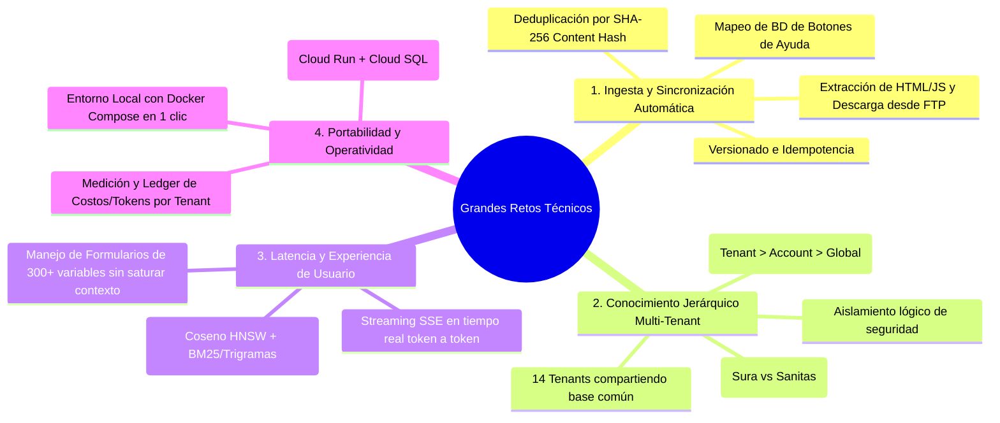
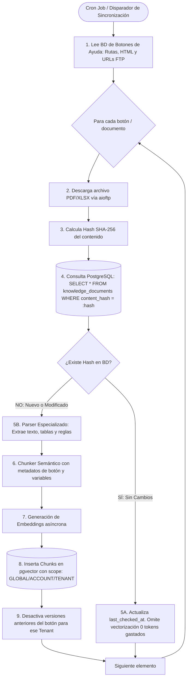
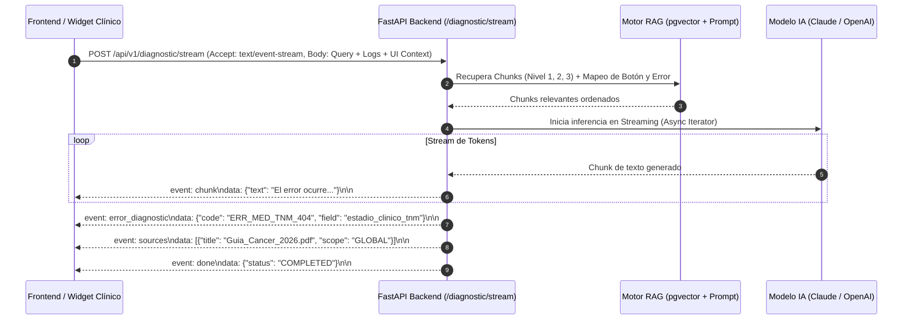
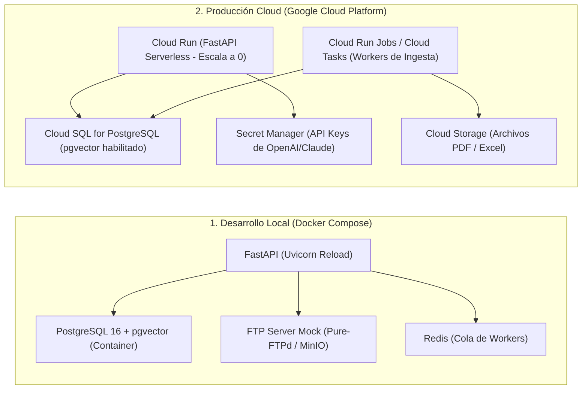

# Arquitectura del Sistema, Retos Técnicos y Guía de Implementación (Python Core)
## SaaS B2B de Asistencia Inteligente y Diagnóstico RAG Multi-Nivel (Sector Salud)

> **Documento:** Arquitectura Técnica Integral, Retos Críticos y Estrategia de Implementación en Python.  
> **Destinatarios:** Arquitectos de Software, Desarrolladores Backend/IA, DevOps y Líderes Técnicos.  
> **Stack Principal:** Python 3.12+ (FastAPI, Pydantic v2, SQLAlchemy Async, pgvector) + Arquitectura Limpia / Hexagonal.

---

## 1. Resumen Ejecutivo y Caso de Negocio

El sistema es un **Core Backend y Motor RAG (Retrieval-Augmented Generation) Multi-Nivel** desarrollado en **Python 3.12+** bajo principios de **Clean Architecture (Puertos y Adaptadores)** y **POO robusta**.

Su misión es brindar asistencia técnica y normativa en tiempo real a plataformas clínicas de salud compuestas por un **Account Principal (empresa prestadora)** y sus **14+ Tenants (IPSs / Clínicas / Aseguradoras como Sura, Sanitas, etc.)**.

El sistema resuelve consultas complejas sobre:
1. **Cargues Masivos y Formularios Clínicos de Alto Costo:** Formularios de más de 300 variables (ej. Cáncer Tipo 2, cuentas médicas, validaciones normativas del ministerio).
2. **Diagnóstico Inteligente de Logs de Error:** Recepción de trazas de fallo y códigos de validación (`ERR_MED_TNM_404`), traduciéndolos a lenguaje funcional con pasos de remediación exactos.
3. **Mapeo de Navegación y Botones de Ayuda:** Contextualización precisa según la pantalla activa, el botón presionado y el rol del usuario (médico, auditor, radicador).

---

## 2. Los Grandes Retos Técnicos del Proyecto



### Reto 1: Ingesta Asíncrona desde BD Existente y Archivos en Servidor FTP
- **Contexto:** Actualmente, los botones de ayuda de la aplicación clínica están mapeados en una base de datos relacional. Dicha base contiene la ruta del botón, un fragmento de HTML/JavaScript con el texto instructivo y los enlaces a archivos PDF o Excel almacenados en un servidor **FTP**.
- **Solución Técnica:** Un worker asíncrono en Python que:
  1. Lee la base de datos de origen y extrae los textos de ayuda y URLs del FTP.
  2. Descarga los archivos (PDFs normativos, matrices Excel de campos) vía cliente FTP asíncrono.
  3. Calcula el **hash SHA-256 (`content_hash`)** del archivo y del texto instructivo.
  4. Si el hash ya existe en `pgvector`, **no gasta tokens ni recalcula embeddings** (deduplicación total).
  5. Si el hash cambió o es nuevo, genera los chunks, calcula embeddings y los asocia al identificador del botón (`button_id`) y a la ruta de la pantalla (`screen_route`).

### Reto 2: Deduplicación y Manejo de Diferencias entre Tenants (Sura vs. Sanitas vs. Otros)
- **Contexto:** 14 tenants utilizan el 95% de las mismas reglas de cargue de cáncer, pero una aseguradora (ej. Sura) puede requerir una validación particular o un archivo con parámetros diferentes.
- **Solución Técnica:**
  - **Deduplicación Canónica:** Si Sura y Sanitas tienen el mismo archivo, se almacena una sola vez a nivel `ACCOUNT` (`scope = 'ACCOUNT'`), ahorrando más del 90% de costos de base vectorial y vectorización.
  - **Manejo de Discrepancias (Tenant Overrides):** Si Sura actualiza su archivo, el worker detecta el nuevo hash y crea los chunks con `scope = 'TENANT'` y `tenant_id = 'sura'`. En el momento de la consulta, el motor RAG pondera con mayor relevancia los chunks del Tenant sobre los del Account.

### Reto 3: Mapeo de Formularios Extensos (300+ Campos) y Diagnóstico de Logs
- **Contexto:** Un formulario de radicación de cáncer tiene más de 300 campos. No se puede inyectar todo el manual de 300 campos en el prompt del LLM porque dispararía los costos y la latencia.
- **Solución Técnica:** Chunking semántico modular por secciones (ej. *Datos Generales*, *Estadificación TNM*, *Tratamiento Oncológico*) indexando en el metadato JSON del chunk el nombre exacto de las variables (`field_name`) y los códigos de error posibles (`error_code`). Cuando el front envía `field_in_focus: "estadio_clinico_tnm"` o el log `ERR_MED_TNM_404`, la búsqueda vectorial filtra quirúrgicamente ese bloque específico.

---

## 3. Arquitectura del Sistema (Clean Architecture en Python)

Se implementa una **Arquitectura Hexagonal (Ports & Adapters)** modular en Python 3.12+:

```
backend/
├── src/
│   ├── domain/                         # Capa de Dominio (Pura, sin frameworks)
│   │   ├── entities/                   # Entidades POO (Tenant, Document, Chunk, DiagnosticSession)
│   │   ├── value_objects/              # Scope (GLOBAL, ACCOUNT, TENANT), ContentHash, ErrorCode
│   │   └── exceptions/                 # Excepciones de dominio
│   │
│   ├── application/                    # Casos de Uso y Puertos (Interfaces)
│   │   ├── ports/                      # Interfaces abstractas (ABC)
│   │   │   ├── vector_store_port.py    # Puerto para pgvector
│   │   │   ├── llm_port.py             # Puerto para Claude/OpenAI/DeepSeek
│   │   │   ├── embedding_port.py       # Puerto para generación de embeddings
│   │   │   ├── ftp_client_port.py      # Puerto para descarga de archivos del FTP
│   │   │   └── source_db_port.py       # Puerto para leer la BD de botones de ayuda
│   │   └── use_cases/                  # Casos de Uso del negocio
│   │       ├── diagnose_query_use_case.py
│   │       ├── sync_ftp_help_buttons_use_case.py
│   │       └── ingest_document_use_case.py
│   │
│   ├── infrastructure/                 # Adaptadores e Implementaciones
│   │   ├── db/                         # SQLAlchemy 2.0 Async + asyncpg + pgvector
│   │   │   ├── models/                 # Modelos ORM (PostgreSQL)
│   │   │   └── repositories/           # Implementación de repositorios
│   │   ├── ai/                         # Clientes LLM y Embeddings (LiteLLM / AsyncOpenAI / Anthropic)
│   │   ├── ftp/                        # Cliente aioftp para sincronización de archivos
│   │   └── workers/                    # Workers asíncronos (ARQ / Celery / Cron AsyncIO)
│   │
│   └── api/                            # Adaptador Primario (FastAPI)
│       ├── v1/
│       │   ├── diagnostic_router.py    # Endpoints /query y /stream (SSE)
│       │   ├── widget_session_router.py # Autenticación de widgets y validación de origen
│       │   └── admin_router.py         # Endpoints para las consolas web de gestión
│       └── middlewares/                # CORS dinámico, validación de API Keys, rate limit
```

---

## 4. Pipeline de Ingesta Asíncrona: BD de Botones + FTP + Hash Deduplication



### Algoritmo de Deduplicación y Sincronización en Python:

```python
import hashlib
from typing import Optional
from src.domain.entities.document import KnowledgeDocument
from src.application.ports.ftp_client_port import FTPClientPort
from src.application.ports.vector_store_port import VectorStorePort

class SyncFtpHelpButtonsUseCase:
    def __init__(
        self, 
        ftp_client: FTPClientPort, 
        vector_store: VectorStorePort,
        embedding_service
    ):
        self.ftp_client = ftp_client
        self.vector_store = vector_store
        self.embedding_service = embedding_service

    async def execute(self, button_meta: dict, tenant_id: Optional[str] = None):
        # 1. Descargar archivo del FTP
        file_bytes = await self.ftp_client.download_file(button_meta["ftp_path"])
        
        # 2. Calcular SHA-256
        content_hash = hashlib.sha256(file_bytes).hexdigest()
        
        # 3. Comprobar si ya existe el hash
        existing_doc = await self.vector_store.find_document_by_hash(content_hash)
        if existing_doc and existing_doc.is_active:
            # Idempotencia: el archivo no ha cambiado
            await self.vector_store.touch_document_checked(existing_doc.id)
            return {"status": "SKIPPED_UNCHANGED", "hash": content_hash}

        # 4. Si es nuevo o modificado, procesar y vectorizar
        parsed_chunks = self.parse_content(file_bytes, button_meta)
        embeddings = await self.embedding_service.generate_batch([c.text for c in parsed_chunks])
        
        # 5. Guardar en pgvector con el scope correspondiente
        await self.vector_store.save_document_and_chunks(
            doc_metadata=button_meta,
            content_hash=content_hash,
            chunks=parsed_chunks,
            embeddings=embeddings,
            tenant_id=tenant_id
        )
        return {"status": "INGESTED_NEW_VERSION", "hash": content_hash}
```

---

## 5. Tipo de Comunicación Web: ¿Por qué SSE (Server-Sent Events)?



### Justificación Técnica de Protocolos:
1. **Server-Sent Events (SSE):** Protocolo estándar sobre HTTP/1.1 y HTTP/2. Ideal para RAG porque la comunicación cliente $\rightarrow$ servidor es una única petición enriquecida, mientras que la respuesta servidor $\rightarrow$ cliente requiere streaming token a token. No sufre de desconexiones complejas, no requiere servidores de estado y es 100% compatible con Cloud Run y balanceadores de carga.
2. **REST Síncrono (`POST /query`):** Se mantiene como alternativa para clientes que no deseen renderizar efecto máquina de escribir o para llamadas entre servidores.
3. **WebSockets (Descartado):** Innecesario y contraproducente en este contexto: exige mantener sockets TCP abiertos persistentemente, lo que eleva el consumo de memoria, complica el escalado horizontal y genera bloqueos en firewalls corporativos de hospitales.

---

## 6. Modelo de Datos y PostgreSQL con `pgvector`

```sql
-- Extensiones requeridas
CREATE EXTENSION IF NOT EXISTS "uuid-ossp";
CREATE EXTENSION IF NOT EXISTS "vector";
CREATE EXTENSION IF NOT EXISTS "pg_trgm";

-- 1. Tenants y Cuentas
CREATE TABLE accounts (
    account_id UUID PRIMARY KEY DEFAULT uuid_generate_v4(),
    nombre VARCHAR(255) NOT NULL,
    plan VARCHAR(50) NOT NULL DEFAULT 'ENTERPRISE_HEALTH',
    created_at TIMESTAMP WITH TIME ZONE DEFAULT NOW()
);

CREATE TABLE tenants (
    tenant_id UUID PRIMARY KEY DEFAULT uuid_generate_v4(),
    account_id UUID NOT NULL REFERENCES accounts(account_id) ON DELETE CASCADE,
    nombre VARCHAR(255) NOT NULL,
    codigo_ips VARCHAR(100),
    dominios_permitidos TEXT[] NOT NULL DEFAULT '{}',
    created_at TIMESTAMP WITH TIME ZONE DEFAULT NOW()
);

-- 2. Documentos y Control de Hash
CREATE TYPE knowledge_scope_enum AS ENUM ('GLOBAL', 'ACCOUNT', 'TENANT');
CREATE TYPE document_category_enum AS ENUM ('NORMATIVA_SALUD', 'GUIA_CARGUE', 'MAPA_UI_BOTONES', 'CATALOGO_ERRORES');

CREATE TABLE knowledge_documents (
    document_id UUID PRIMARY KEY DEFAULT uuid_generate_v4(),
    scope knowledge_scope_enum NOT NULL,
    account_id UUID REFERENCES accounts(account_id) ON DELETE CASCADE,
    tenant_id UUID REFERENCES tenants(tenant_id) ON DELETE CASCADE,
    titulo VARCHAR(255) NOT NULL,
    categoria document_category_enum NOT NULL,
    source_url TEXT,                              -- Ruta FTP o URL de origen
    content_hash VARCHAR(64) NOT NULL,            -- SHA-256 del contenido
    version INT NOT NULL DEFAULT 1,
    is_active BOOLEAN NOT NULL DEFAULT TRUE,
    metadatos_doc JSONB DEFAULT '{}',             -- { "button_id": "btn_radicar", "screen": "FORM_CANCER" }
    last_checked_at TIMESTAMP WITH TIME ZONE DEFAULT NOW(),
    uploaded_at TIMESTAMP WITH TIME ZONE DEFAULT NOW()
);

-- 3. Chunks Vectoriales
CREATE TABLE knowledge_chunks (
    chunk_id UUID PRIMARY KEY DEFAULT uuid_generate_v4(),
    document_id UUID NOT NULL REFERENCES knowledge_documents(document_id) ON DELETE CASCADE,
    scope knowledge_scope_enum NOT NULL,
    account_id UUID REFERENCES accounts(account_id),
    tenant_id UUID REFERENCES tenants(tenant_id),
    contenido TEXT NOT NULL,
    embedding VECTOR(1536) NOT NULL,              -- 1536 dimensiones (OpenAI / DeepSeek / Cohere)
    metadatos_chunk JSONB NOT NULL DEFAULT '{}',  -- { "campo": "estadio_tnm", "error_asociado": "ERR_MED_TNM_404" }
    is_active BOOLEAN NOT NULL DEFAULT TRUE,
    created_at TIMESTAMP WITH TIME ZONE DEFAULT NOW()
);

-- Índices HNSW y de Metadatos
CREATE INDEX idx_chunks_embedding_hnsw ON knowledge_chunks 
USING hnsw (embedding vector_cosine_ops) WITH (m = 16, ef_construction = 64);

CREATE INDEX idx_chunks_metadata_gin ON knowledge_chunks USING gin (metadatos_chunk);
CREATE INDEX idx_docs_hash ON knowledge_documents (content_hash);
CREATE INDEX idx_chunks_query_hierarchy ON knowledge_chunks (scope, account_id, tenant_id, is_active);
```

---

## 7. Estrategia de Despliegue: Local vs. Cloud (GCP)



### 7.1 Facilidad de Desarrollo Local (1 solo comando)
Con un archivo `docker-compose.yml`, cualquier desarrollador levanta el entorno completo en segundos:
- Contenedor de PostgreSQL con la extensión `vector` preinstalada.
- Servidor FTP local simulado con los archivos de prueba de cargue de cáncer.
- Redis para la gestión de colas de ingesta.
- FastAPI con *hot-reloading* automático en Python.

### 7.2 Despliegue en GCP (Arquitectura Serverless y Costo-Eficiente)
- **Cómputo:** **Google Cloud Run** para la API FastAPI. Escala de 0 a $N$ instancias según la demanda de los médicos; si no hay consultas de noche, el costo de cómputo es \$0.
- **Base de Datos:** **Cloud SQL for PostgreSQL 16**, activando la extensión `pgvector` nativa con un clic.
- **Tareas Asíncronas:** **Cloud Tasks** o **Cloud Run Jobs** para disparar la sincronización semanal con los servidores FTP de los clientes.
- **Seguridad:** **Secret Manager** para credenciales y certificados.

---

## 8. Checklist de lo que Necesitamos para Empezar el Proyecto

Para arrancar el desarrollo inmediatamente, los requisitos indispensables son:

```
PASO 1: Repositorio y Dependencias Base
├── Python 3.12+ con gestor moderno (uv o poetry)
├── Frameworks: FastAPI, Uvicorn, Pydantic v2, SQLAlchemy 2.0, asyncpg, pgvector
├── Clientes IA: litellm / openai / anthropic
└── Procesamiento Documental: openpyxl, pypdf / pdfplumber, beautifulsoup4, aioftp

PASO 2: Infraestructura Local (docker-compose.yml)
├── Servicio 'postgres' (imagen: pgvector/pgvector:pg16)
└── Servicio 'redis' o servidor FTP mock

PASO 3: Acceso a Datos del Cliente
├── Esquema o muestra de la tabla de botones de ayuda (campos, rutas, HTML)
├── Credenciales o muestra de archivos del servidor FTP (PDFs normativos, Excels de cargue)
└── Catálogo o lista de códigos de error clínicos conocidos (ej. ERR_MED_TNM_404)

PASO 4: Claves de API de Proveedores de IA
└── API Keys de OpenAI (embeddings text-embedding-3-small) y Claude 3.5 Sonnet / DeepSeek
```

---

## 9. Resumen de Ventajas de la Arquitectura Python

| Aspecto | Beneficio para el Proyecto |
|---|---|
| **Ecosistema de IA Nativo** | Python cuenta con el soporte de primera clase para bibliotecas de parsing documental (`pdfplumber`, `openpyxl`, `BeautifulSoup`), drivers de `pgvector` y frameworks de IA. |
| **Velocidad de Desarrollo** | FastAPI + Pydantic v2 ofrecen tipado estricto, serialización en Rust (ultrarrápida) y generación automática de documentación OpenAPI / Swagger. |
| **Arquitectura Limpia & POO** | Separación estricta de responsabilidades (Dominio $\rightarrow$ Casos de Uso $\rightarrow$ Infraestructura), garantizando que el código sea testeable, mantenible y desacoplado de proveedores externos. |
| **Ahorro de Costos por Deduplicación** | El sistema de hashes SHA-256 evita vectorizar dos veces el mismo contenido entre los 14 tenants. |
