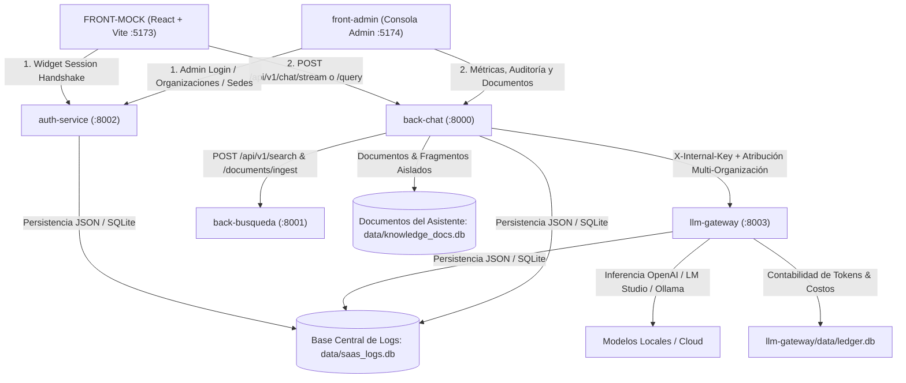

# Arquitectura de Microservicios y Separación de Dependencias

**Desarrollado por:** Juan Camilo Avendaño, Fran Sneider Quincha, Adriana Moreno.  
**Fecha:** Octubre 2026  
**Ecosistema:** SaaS Core Chat & RAG Gateway Multi-Organización

---

## 1. Visión General de la Separación de Servicios

Para garantizar alta disponibilidad, aislamiento de fallos, auditoría estricta y control de costos de inteligencia artificial entre múltiples organizaciones y sus sedes (tiendas, talleres, sucursales o IPS/clínicas), se separaron las dependencias en tres microservicios FastAPI dedicados, respaldados por una base central de auditoría y dos frontends:



---

## 2. Mapa de Puertos y Responsabilidades

| Microservicio | Puerto | Ruta | Responsabilidades Principales |
|---|---|---|---|
| **`auth-service`** | **8002** | `codigo/auth-service` | • Handshake mínimo de widgets (`POST /api/v1/widget/session`, acepta `{}` u `origin` + `org_id`, `site_code` y `metadata` opcional).<br>• Registro y gestión administrativa de organizaciones (`/api/v1/admin/organizations`, incluyendo etiquetas `site_label` / `site_label_plural` configurables incluso por su `ORG_ADMIN`) y sedes con hashing SHA-256 y rotación de claves de conexión (`/api/v1/admin/sites`).<br>• Autenticación de administradores (`bcrypt`) y gestión vía `/api/v1/admin/users`.<br>• Control de roles (`GLOBAL_ADMIN` vs `ORG_ADMIN`) y bloqueo temporal tras 5 intentos fallidos (15 min). |
| **`llm-gateway`** | **8003** | `codigo/llm-gateway` | • Aislamiento completo de llamadas a modelos (LM Studio, Ollama, OpenAI).<br>• Segmentación de atribución: `org_id`, `site_id`, `site_code`, `usuario`, `rol`, `operacion`, `model`.<br>• Medición de tokens reales (`tiktoken`/API) y estimación de costos en USD.<br>• Registro de respuestas directas sin costo (`is_llm_call=false`, `0` tokens consumidos).<br>• Protegido mediante token interno `X-Internal-Key`. |
| **`back-chat`** | **8000** | `codigo/back-chat` | • Orquestador genérico multi-organización en `POST /api/v1/chat/stream` y `POST /api/v1/chat/query` (y alias `/api/v1/diagnostic/*` por compatibilidad).<br>• Acepta peticiones mínimas (`{"query": "..."}`) u opcionalmente enriquecidas (`user`, `context`, `logs`, `extras`, `conversation_history`).<br>• **System Prompt desacoplado:** adapta el asistente a cada organización (`org_name`) sin quemar reglas de negocio.<br>• **Contexto guiado por Búsqueda (RAG) + Ingesta Admin:** consulta `back-busqueda` (:8001) enrutando por `org_id`/`site_id` y expone `/api/v1/admin/documents*` para cargar, deduplicar (SHA-256), inspeccionar fragmentos y sincronizar documentos por sede (`SITE`), organización (`ORGANIZATION`) o globales (`GLOBAL`) en `codigo/data/knowledge_docs.db`.<br>• Anonimización PII / PHI obligatoria (Ley Estatutaria 1581 de 2012) y guardrails pre-LLM.<br>• Extracción condicional de metadatos cuando hay `logs` técnicos (`error_diagnostic: null` si no aplica).<br>• Emisión Server-Sent Events (SSE) y proxy de logs/métricas para administradores. |
| **`FRONT-MOCK`** | **5173** | `codigo/FRONT-MOCK` | • Simulador de widget multi-organización con organización genérica por defecto (`otra_empresa` — `Sede Operativa Central`) y ejemplos del sector salud (`sigires` — `IPS`), retail y automotriz.<br>• Soporte de **Modo Petición Mínima** y modo enriquecido (`user`, `context`, `logs`, `extras`).<br>• Inspector SSE en tiempo real y modal administrativo de observabilidad. |
| **`front-admin`** | **5174** | `codigo/front-admin` | • Consola administrativa React + Vite para **`GLOBAL_ADMIN`** (*Admin Global*) y **`ORG_ADMIN`** (*Administrador*).<br>• Terminología dinámica por organización (`Sede/Sedes`, `Tienda/Tiendas`, `Taller/Talleres`, `Sucursal/Sucursales`, `Clínica/Clínicas`, `IPS/IPS`).<br>• Visualización de consumo, costos, respuestas directas (sin costo), latencias y tendencias diarias por sede, usuario, rol y modelo.<br>• Descarga de reportes comparativos y logs en **CSV (UTF-8 BOM)** y **JSON**.<br>• Gestión de sedes, claves de conexión (`pk_live_*`) y panel **Organizaciones y Accesos** (`GLOBAL_ADMIN`).<br>• Carga drag-and-drop de documentos (`.pdf`, `.xlsx`, `.csv`, `.docx`, `.txt`, `.md`, `.json`) al asistente de cada sede con verificación de fragmentos y deduplicación SHA-256. |

---

## 3. Sistema Centralizado de Logs y Auditoría

Cada microservicio implementa el motor común `src/core/logging_system.py`:
1. **Logs en Archivos Rotativos JSON Lines:**
   - Ubicación: `<microservicio>/logs/<servicio>.jsonl`
   - Tamaño máximo: 10 MB por archivo, 10 copias de seguridad rotativas.
   - Formato estructurado: `timestamp`, `level`, `service`, `request_id`, `logger`, `message`, `audit_data`.
2. **Base de Datos Centralizada de Auditoría:**
   - Archivo compartido: `codigo/data/saas_logs.db` (SQLite en modo WAL; configurable hacia PostgreSQL mediante `LOGS_DATABASE_URL`, con migración automática de esquemas SQLite legacy al arrancar).
   - Tablas principales:
     - `security_events`: Bloqueos por inyección de prompts, fallos de autenticación, violaciones de origen y consultas fuera de dominio (incluye `org_id` y `site_id`).
     - `message_logs`: Entrada y salida de mensajes sanitizados con tokens, latencia en ms, `org_id`, `site_id`, usuario y rol.
     - `system_errors`: Trazas de excepciones con Request ID correlacionado.

---

## 4. Segmentación de Quienes Hacen Consultas a los Modelos

En el **`llm-gateway`** (:8003), cada petición al endpoint `/internal/v1/chat` registra el contexto de atribución:
- **`org_id`**: Identificador de la organización (ej. `otra_empresa`, `sigires`).
- **`site_id`**: Identificador UUID de la sede (tienda, taller, sucursal o IPS).
- **`site_code`**: Código corto opcional de la sede (ej. `SEDE-NORTE-01`, `110010999901`).
- **`usuario`**: Identificador del usuario final (ej. `ana.martinez`, `dr.juan.perez`, o `anonimo` si no se envía `user`).
- **`rol`**: Rol del usuario (`ANALISTA_OPERACIONES`, `ANALISTA_COMPRAS`, `PERFIL_IPS_MEDICO`, `usuario`, etc.).
- **`model`**: Modelo de lenguaje utilizado (`local-model`, `gpt-4o-mini`, etc.).
- **`operacion`**: Tipo de consulta (`CHAT_QUERY`, `CHAT_STREAM`, `FAST_RESPONSE_GREETING`, `SECURITY_BLOCKED`, `OUT_OF_DOMAIN`, etc.).
- **`is_llm_call`**: Booleano que diferencia si hubo inferencia en el modelo o si fue una respuesta directa sin costo (`0` tokens).

Endpoints de consulta administrativa en `llm-gateway` (expuestos vía proxy en `back-chat` `/api/v1/admin/usage/*`, admiten filtros temporales `days`, `date_from`, `date_to`, `org_id` y `site_id`):
- `GET /api/v1/usage`: Resumen consolidado.
- `GET /api/v1/usage/timeseries`: Serie temporal diaria (`requests`, `tokens`, `cost_usd`).
- `GET /api/v1/usage/by-user`: Consumo agrupado por usuario.
- `GET /api/v1/usage/by-role`: Consumo agrupado por rol (con desglose `total_tokens_input`/`output`).
- `GET /api/v1/usage/by-model`: Rendimiento, llamadas, tokens y latencia promedio agrupado por modelo.
- `GET /api/v1/usage/by-site`: Facturación, volumen y latencia promedio por sede.
- `GET /api/v1/usage/records`: Paginación detallada de transacciones.

---

## 5. Credenciales y Organizaciones Sembradas de Prueba

### Administradores (`auth-service` :8002):
| Usuario | Contraseña Inicial | Rol | Notas |
|---|---|---|---|
| `superadmin` | Valor de `BOOTSTRAP_ADMIN_PASSWORD` en `.env` (`AdminPassword2026!` en `.env.example`) | `GLOBAL_ADMIN` | Se crea automáticamente si la tabla de admins está vacía. Acceso global a todas las organizaciones, sedes, métricas y logs. |
| *(Opcional)* `ORG_ADMIN` | Definida al crear el usuario | `ORG_ADMIN` | No se siembra por defecto; un `GLOBAL_ADMIN` puede crearlo vía `POST /api/v1/admin/users` asignándole `org_id` (ej. `otra_empresa` o `sigires`). |

### Claves de Conexión de Widgets (`auth-service/src/db/seed.py`):
| Organización (`org_id`) | Sede (`site_name`) | Código (`site_code`) | Clave de conexión | Orígenes Permitidos |
|---|---|---|---|---|
| `otra_empresa` (Organización Demo Central) | `Sede Operativa Central` | `SEDE-CTRL-01` | `pk_live_otraempresa_1a2b3c4d5e6f7a8b` | `*` |
| `sigires` (Procex Software S.A.S) | `IPS San Vicente - Regional Nor-Occidente` | `110010999901` | `pk_live_sigires_8f9a2b1c3d4e5f6a` | `https://sigires.procex.co`, `http://localhost:3000`, `http://localhost:5173` |
| `sigires` (Procex Software S.A.S) | `IPS San Rafael` | `110010999902` | `pk_live_sigires_sanitas_7c9d1e2f3a4b` | `https://sigires.procex.co`, `http://localhost:3000`, `http://localhost:5173` |
| `sigires` (Procex Software S.A.S) | `IPS Norte - Consorcio Salud` | `110010999903` | `pk_live_sigires_nuevaeps_9e8d7c6b5a4f` | `https://sigires.procex.co`, `http://localhost:3000`, `http://localhost:5173` |

---

## 6. Instrucciones de Ejecución

Para iniciar todos los servicios simultáneamente en ventanas de terminal independientes:

```powershell
cd d:\Git\SaaS\codigo
.\iniciar-servicios.ps1
```

O para iniciar individualmente:

```powershell
# 1. Auth Service
cd d:\Git\SaaS\codigo\auth-service
$env:DISABLE_SQLALCHEMY_CEXT="1"; uvicorn src.main:app --port 8002 --reload

# 2. LLM Gateway
cd d:\Git\SaaS\codigo\llm-gateway
$env:DISABLE_SQLALCHEMY_CEXT="1"; uvicorn src.main:app --port 8003 --reload

# 3. Back Central Chat
cd d:\Git\SaaS\codigo\back-chat
$env:DISABLE_SQLALCHEMY_CEXT="1"; uvicorn src.main:app --port 8000 --reload

# 4. Frontend Mock (Simulador)
cd d:\Git\SaaS\codigo\FRONT-MOCK
npm run dev

# 5. Front Admin (Consola Administrativa :5174)
cd d:\Git\SaaS\codigo\front-admin
npm run dev
```

### Ejecutar Pruebas Automatizadas y Compilaciones Frontend:
```powershell
pytest -v d:\Git\SaaS\codigo\auth-service\tests
pytest -v d:\Git\SaaS\codigo\llm-gateway\tests
pytest -v d:\Git\SaaS\codigo\back-chat\tests
cd d:\Git\SaaS\codigo\front-admin; npm run build
```
