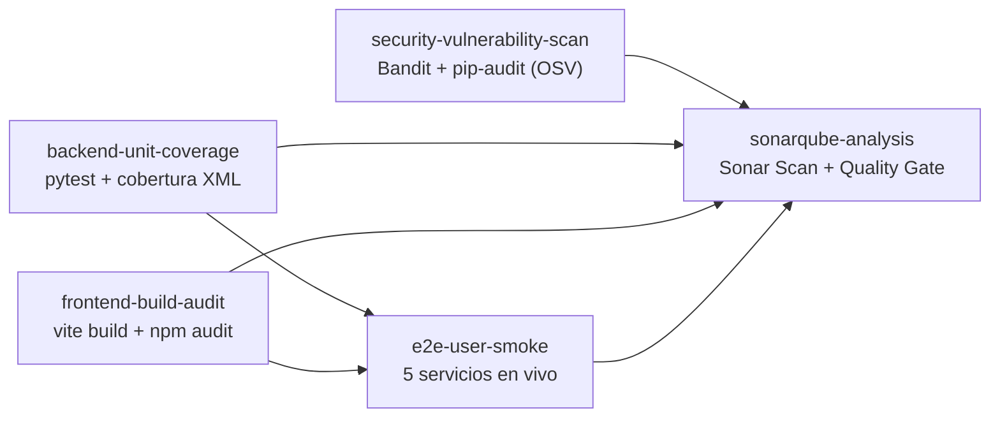

# Pipeline CI/CD, Cobertura E2E y SonarQube — Atenta

Este documento describe el flujo automatizado de calidad, cobertura de código, pruebas de humo (*smoke tests*) de usuario y análisis de vulnerabilidades con **SonarQube (self-hosted)** al hacer `git push`.

---

## 1. Arquitectura del Pipeline en GitHub Actions

El workflow está definido en [`.github/workflows/ci.yml`](../.github/workflows/ci.yml) y se dispara automáticamente en cada `push` y en los `pull_request` hacia `main` o `develop`.



### Etapas y umbrales configurados

| Job | Qué valida | Criterio de aprobación |
|---|---|---|
| `backend-unit-coverage` | Ejecuta `pytest` + `pytest-cov` en `auth-service`, `llm-gateway` y `back-chat`, genera reportes Cobertura XML normalizados ([`normalize_coverage.py`](scripts/normalize_coverage.py)) y JUnit XML. | `100%` de tests aprobados + cobertura mínima: `>= 78%` (`auth-service`, `llm-gateway`) y `>= 72%` (`back-chat`). |
| `frontend-build-audit` | Ejecuta `npm ci` + `npm run build` en `front-admin` y `FRONT-MOCK`, además de `npm audit`. | Build Vite sin errores + `0` vulnerabilidades `high`/`critical` en dependencias de producción (`--omit=dev`). |
| `security-vulnerability-scan` | Ejecuta **Bandit** (configurado en [`.bandit`](../.bandit), exportando `reports/bandit-report.json`) y **`pip-audit`** contra la base OSV sobre los tres `requirements.txt`. | `0` hallazgos `HIGH` en Bandit + `0` CVEs abiertos en dependencias Python. |
| `e2e-user-smoke` | Levanta en puertos aislados los 5 servicios (`auth-service`, `llm-gateway`, `back-chat`, `FRONT-MOCK`, `front-admin`) con [`e2e_smoke_test.py`](scripts/e2e_smoke_test.py) y prueba flujo completo de usuario final y administrador (handshake widget, saludo fast-path, `/chat/query`, streaming SSE `/chat/stream`, bloqueo Prompt Injection, carga documental `SITE`, aislamiento entre organizaciones y métricas). | Salida `0` en todos los pasos `[OK]` y cierre limpio de los 5 puertos. |
| `sonarqube-analysis` | Descarga los reportes de cobertura, JUnit y Bandit y lanza el escáner contra tu instancia self-hosted usando [`sonar-project.properties`](../sonar-project.properties), verificando después el **Quality Gate**. | Paso verde en SonarQube Quality Gate (si aún no configuras los secretos, deja un aviso en el *Summary* sin bloquear el push inicial). |

---

## 2. Cómo Activar Tu Servidor SonarQube Self-Hosted

1. Crea un proyecto manual en tu SonarQube con clave **`atenta-platform`**.
2. Genera un token de análisis (*Project Analysis Token* o *User Token*).
3. Agrega dos secretos en tu repositorio de GitHub (**Settings -> Secrets and variables -> Actions -> Repository secrets**):
   - **`SONAR_HOST_URL`**: URL pública accesible por GitHub Actions de tu servidor SonarQube (ej. `https://sonar.tu-empresa.com`).
   - **`SONAR_TOKEN`**: token generado en SonarQube.
4. *(Recomendado)* Para que `sonarqube-quality-gate-action` reciba el estado al instante, configura tu servidor SonarQube accesible vía HTTPS (o verifica que `pollingTimeoutSec: 300` pueda consultar el Compute Engine task).

---

## 3. Verificación Local Pre-Push (Opcional o Hook Automático)

Puedes correr localmente exactamente el mismo pipeline antes de hacer `git push` sin bloquear tu flujo cuando trabajes sin red:

```powershell
# Verificación completa local (tests + cobertura + npm build/audit + Bandit + pip-audit + smoke E2E)
.\codigo\scripts\pre-push-check.ps1

# Solo pruebas rápidas y builds (sin Bandit/pip-audit ni smoke E2E)
.\codigo\scripts\pre-push-check.ps1 -SkipSecurity -SkipE2E

# Activar como hook git pre-push obligatorio en este equipo (bloquea git push si falla)
.\codigo\scripts\pre-push-check.ps1 -InstallHook

# Desactivar el hook git pre-push si deseas volver al modo manual
.\codigo\scripts\pre-push-check.ps1 -UninstallHook
```
