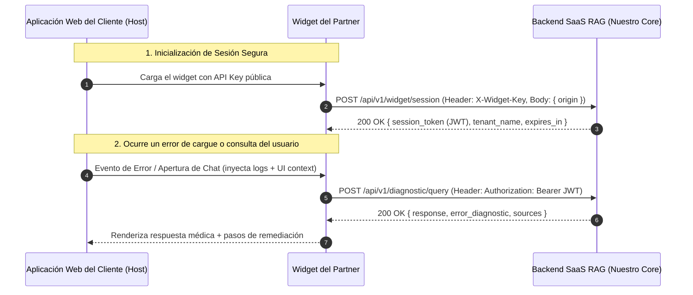

# Especificación de Integración de API para Frontend y Widget
## Core RAG y Motor de Diagnóstico Inteligente — Sector Salud

> **Dirigido a:** Equipo de Desarrollo Frontend y Líderes Técnicos del Partner / Cliente.
> **Propósito:** Especificar el contrato de comunicación, endpoints REST/SSE, esquemas de payload y mejores prácticas para integrar el widget conversacional y la captura de contexto en su plataforma clínica web.

---

## 1. Flujo General de Integración



---

## 2. Endpoints de la API

### 2.1 Inicializar Sesión del Widget

`POST /api/v1/widget/session`

Este endpoint valida que la API Key corresponda a la IPS/Tenant correcta y que el dominio de la página web esté en la lista blanca autorizada.

#### Headers
| Header | Tipo | Requerido | Descripción |
|---|---|---|---|
| `Content-Type` | String | Sí | `application/json` |
| `X-Widget-Key` | String | Sí | API Key pública del Tenant (ej. `pk_live_8f9a2b1c4e5d6...`) |

#### Request Body
```json
{
  "origin": "https://ips-sanrafael.med.co"
}
```

#### Response Body (`200 OK`)
```json
{
  "session_token": "eyJhbGciOiJIUzI1NiIsInR5cCI6IkpXVCJ9...",
  "tenant_id": "9b1deb4d-3b7d-4bad-9bdd-2b0d7b3dcb6d",
  "tenant_name": "IPS San Rafael",
  "expires_in_seconds": 1800
}
```

---

### 2.2 Consulta y Diagnóstico RAG (Modo Síncrono)

`POST /api/v1/diagnostic/query`

Endpoint principal para enviar la consulta del usuario junto con los logs de error del sistema y el contexto de la interfaz de usuario.

#### Headers
| Header | Tipo | Requerido | Descripción |
|---|---|---|---|
| `Content-Type` | String | Sí | `application/json` |
| `Authorization` | String | Sí | `Bearer <session_token>` obtenido en el paso anterior |

#### Request Body
```json
{
  "query": "¿Por qué me sale este error al radicar el cargue de cáncer tipo 2?",
  "system_logs": "ERROR [2026-08-22 10:15:02] FormCancerT2Validator: Field 'estadio_clinico_tnm' is required when 'tipo_neoplasia' = 02. Validation code: ERR_MED_TNM_404",
  "ui_context": {
    "current_url": "https://ips-sanrafael.med.co/radicacion/cancer/formulario",
    "active_screen": "RADICACION_PATOLOGIAS_ALTO_COSTO",
    "active_button_id": "btn_validar_y_radicar",
    "form_code": "FORM_CANCER_TIPO_2",
    "field_in_focus": "estadio_clinico_tnm"
  },
  "user_profile": {
    "role": "MEDICO_AUDITOR",
    "user_display_name": "Dr. Juan Pérez"
  }
}
```

#### Descripción de Campos de Entrada
- `query` *(string, obligatorio)*: Pregunta en lenguaje natural formulada por el usuario.
- `system_logs` *(string, opcional)*: Snippet de texto con el log de error, stack trace simplificado o mensaje de error arrojado por el frontend o las APIs del cliente.
- `ui_context` *(object, opcional)*:
  - `current_url`: URL de la pantalla actual.
  - `active_screen`: Identificador de la vista o módulo clínico.
  - `active_button_id`: ID del botón clickeado que originó el error o la consulta.
  - `form_code`: Código del formulario en diligenciamiento (ej. `FORM_CANCER_TIPO_2`, `CUENTAS_MEDICAS_V3`).
  - `field_in_focus`: Campo específico donde se encuentra el cursor del usuario.
- `user_profile` *(object, opcional)*:
  - `role`: Rol del usuario (ej. `MEDICO_ESPECIALISTA`, `AUDITOR_MEDICO`, `RADICADOR_ADM`).
  - `user_display_name`: Nombre para personalización de la respuesta.

#### Response Body (`200 OK`)
```json
{
  "response": "Estimado Dr. Pérez, el error **ERR_MED_TNM_404** se debe a que para neoplasias de tipo Cáncer Tipo 2 es obligatorio registrar la **Estadificación Clínica TNM** según la normativa de Cuentas de Alto Costo.\n\n### Pasos para solucionarlo:\n1. Diríjase a la pestaña **Estadificación** del formulario activo.\n2. Complete los campos de Tumor (T), Nódulo (N) y Metástasis (M).\n3. Haga clic nuevamente en **Validar y Radicar**.",
  "error_diagnostic": {
    "detected_code": "ERR_MED_TNM_404",
    "affected_field": "estadio_clinico_tnm",
    "severity": "BLOCKING",
    "category": "VALIDACION_NORMATIVA_ALTO_COSTO"
  },
  "sources": [
    {
      "document_title": "Guia_Tecnica_Cargue_Cancer_2026.pdf",
      "scope": "GLOBAL",
      "section": "Sección 4.1 - Validación TNM"
    },
    {
      "document_title": "Manual_Operativo_IPS_San_Rafael.pdf",
      "scope": "TENANT",
      "section": "Procedimiento de Radicación"
    }
  ]
}
```

---

### 2.3 Consulta y Diagnóstico RAG con Streaming (Server-Sent Events)

`POST /api/v1/diagnostic/stream`

Para una experiencia de chat en tiempo real con efecto "tipeo" palabra por palabra.

#### Headers
| Header | Tipo | Requerido | Descripción |
|---|---|---|---|
| `Content-Type` | String | Sí | `application/json` |
| `Accept` | String | Sí | `text/event-stream` |
| `Authorization` | String | Sí | `Bearer <session_token>` |

#### Formato de Eventos SSE
```
event: chunk
data: {"text": "Estimado Dr. Pérez, "}

event: chunk
data: {"text": "el error **ERR_MED_TNM_404** se debe a..."}

event: error_diagnostic
data: {"detected_code": "ERR_MED_TNM_404", "affected_field": "estadio_clinico_tnm", "severity": "BLOCKING"}

event: sources
data: [{"document_title": "Guia_Tecnica_Cargue_Cancer_2026.pdf", "scope": "GLOBAL"}]

event: done
data: {"status": "COMPLETED"}
```

---

## 3. Ejemplo de Integración en JavaScript / TypeScript

A continuación se presenta una función utilitaria recomendada para el equipo frontend del cliente:

```typescript
// diagnosticService.ts

interface DiagnosticRequest {
  query: string;
  systemLogs?: string;
  uiContext?: {
    currentUrl: string;
    activeScreen: string;
    activeButtonId?: string;
    formCode?: string;
    fieldInFocus?: string;
  };
  userProfile?: {
    role: string;
    userDisplayName?: string;
  };
}

class HealthAssistantClient {
  private sessionToken: string | null = null;
  private readonly baseUrl = 'https://api.tuplataforma.com';
  private readonly widgetKey: string;

  constructor(widgetKey: string) {
    this.widgetKey = widgetKey;
  }

  public async initSession(): Promise<void> {
    const response = await fetch(`${this.baseUrl}/api/v1/widget/session`, {
      method: 'POST',
      headers: {
        'Content-Type': 'application/json',
        'X-Widget-Key': this.widgetKey,
      },
      body: JSON.stringify({ origin: window.location.origin }),
    });

    if (!response.ok) {
      throw new Error(`Error de autenticación del asistente: ${response.statusText}`);
    }

    const data = await response.json();
    this.sessionToken = data.session_token;
  }

  public async askDiagnostic(req: DiagnosticRequest) {
    if (!this.sessionToken) {
      await this.initSession();
    }

    const response = await fetch(`${this.baseUrl}/api/v1/diagnostic/query`, {
      method: 'POST',
      headers: {
        'Content-Type': 'application/json',
        'Authorization': `Bearer ${this.sessionToken}`,
      },
      body: JSON.stringify({
        query: req.query,
        system_logs: req.systemLogs,
        ui_context: req.uiContext ? {
          current_url: req.uiContext.currentUrl,
          active_screen: req.uiContext.activeScreen,
          active_button_id: req.uiContext.activeButtonId,
          form_code: req.uiContext.formCode,
          field_in_focus: req.uiContext.fieldInFocus,
        } : undefined,
        user_profile: req.userProfile ? {
          role: req.userProfile.role,
          user_display_name: req.userProfile.userDisplayName,
        } : undefined,
      }),
    });

    if (response.status === 401) {
      // Token expirado, renovar y reintentar
      await this.initSession();
      return this.askDiagnostic(req);
    }

    return response.json();
  }
}

export const assistantClient = new HealthAssistantClient('pk_live_TU_API_KEY');
```

---

## 4. Códigos de Estado y Manejo de Errores

| Código HTTP | Causa | Acción Recomendada |
|---|---|---|
| `200 OK` | Consulta procesada con éxito. | Renderizar respuesta y fuentes en el widget. |
| `400 Bad Request` | Payload malformado o campos requeridos faltantes. | Validar estructura JSON enviada. |
| `401 Unauthorized` | API Key inválida o JWT de sesión expirado. | Renovar sesión llamando a `/api/v1/widget/session`. |
| `403 Forbidden` | Dominio de origen no autorizado para esta IPS/Tenant. | Verificar configuración de dominios en la consola de administración. |
| `429 Too Many Requests` | Límite de tasa de consultas excedido para el Tenant. | Mostrar mensaje de espera momentánea al usuario. |
| `500 Internal Error` | Error no controlado en backend o proveedor de IA. | Mostrar mensaje amigable al usuario indicando reintentar en unos segundos. |
