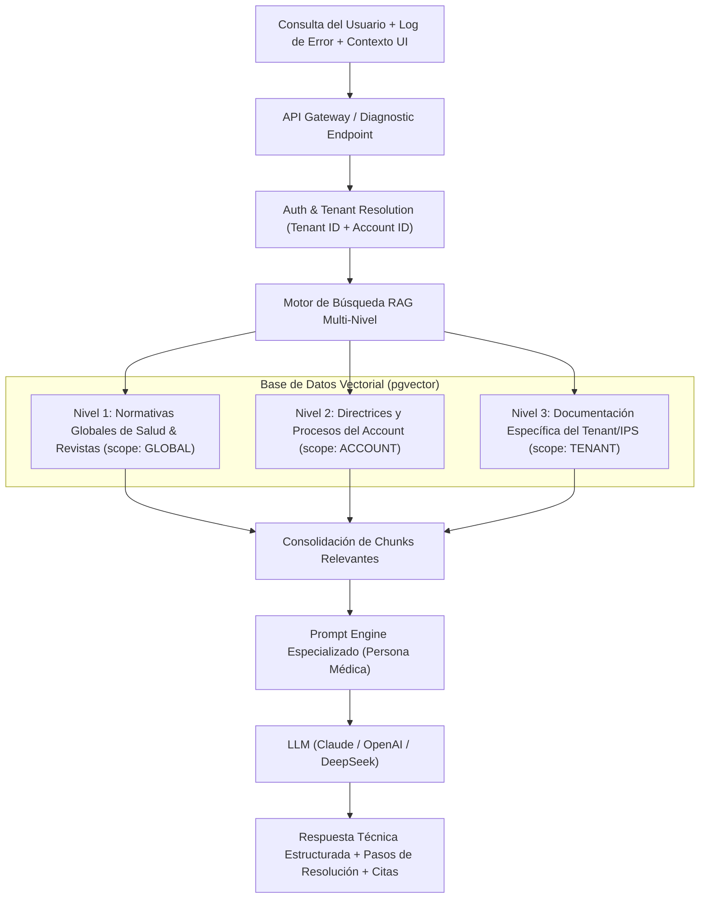

# Especificación del Sistema — SaaS B2B de Asistencia Inteligente y Diagnóstico RAG Multi-Nivel (Sector Salud)

> **Nota para quien lea este documento**: este texto es autocontenido. No asume que el lector (persona o agente de IA) tenga contexto previo de conversaciones anteriores. Todo lo necesario para entender el proyecto está aquí. Donde una decisión aún no está tomada, se marca explícitamente como **[PENDIENTE]** con una recomendación, no se asume nada.

---

## 1. Resumen ejecutivo

Se está desarrollando un **SaaS B2B** de infraestructura y servicios de inteligencia artificial llamado provisionalmente **[NOMBRE_PRODUCTO]** (nombre de marca aún no definido — usar este placeholder en todo material hasta que se confirme).

El producto es un **Core Backend y Motor RAG (Retrieval-Augmented Generation) Multi-Nivel de Alto Rendimiento**, diseñado para asistir a profesionales de la salud, auditores médicos y personal administrativo en la navegación de plataformas clínicas complejas, resolución de errores de cargue de información y cumplimiento normativo.

El sistema se enfoca en tres capacidades críticas:
1. **Asistencia en Procesos Clínicos y Administrativos Complejos:** Guía paso a paso en el diligenciamiento y cargue masivo de datos (ej. formularios de más de 300 campos, radicación de documentos para patologías de alto costo como cáncer tipo 2, cuentas médicas).
2. **Diagnóstico Inteligente de Logs y Errores Técnicos:** Recepción en tiempo real de logs del sistema, códigos de error en pantalla y contexto de navegación (botones y rutas activas), traduciendo fallas complejas a explicaciones en lenguaje natural con tono técnico-médico claro y pasos exactos de resolución.
3. **Ingesta y Herencia de Conocimiento Multi-Nivel:** Capacidad de consultar bases vectoriales estructuradas jerárquicamente (normativas de salud generales, revistas/guías clínicas, reglas corporativas de la empresa prestadora y particularidades de cada IPS o clínica cliente).

### División de Responsabilidades entre Equipos
- **Equipo del Cliente / Partner:** Responsable del frontend de sus aplicaciones web y del desarrollo/integración del widget embebible en la interfaz de usuario.
- **Nuestro Equipo:** Responsable de la **API Backend Core**, el pipeline de ingesta/parseo documental, la base de datos vectorial con herencia multi-tenant, el motor de inferencia RAG con prompts médicos especializados, y las consolas de administración y observabilidad de la plataforma.

---

## 2. Glosario (términos usados en todo el proyecto)

| Término | Significado |
|---|---|
| **Platform** | La plataforma SaaS en sí. Tiene un único operador/dueño (nuestro equipo). |
| **Super-Admin** | Rol del dueño de la Platform. Supervisa el rendimiento global, todos los Accounts, consumo de tokens e infraestructura. |
| **Account** | Empresa prestadora de servicios de salud o revendedora que contrata la Platform. Gestiona a sus propias entidades/clientes. En el caso actual, hay **un Account principal contratado** que presta servicios a múltiples entidades. |
| **Account Admin** | Rol del administrador del Account. Administra sus Tenants, API keys, jerarquías de conocimiento y monitorea el consumo. |
| **Tenant** | Cada empresa cliente final, IPS, clínica o entidad suscrita al Account (actualmente **16 Tenants**). Posee su configuración y base documental local. |
| **Jerarquía de Conocimiento (Multi-Nivel)** | Estructura en árbol donde un Tenant hereda conocimiento normativo global (Nivel 1), directrices del Account prestador (Nivel 2) y documentos locales de su sede (Nivel 3). |
| **RAG (Retrieval-Augmented Generation)** | Técnica que combina búsqueda semántica híbrida sobre la base documental con un LLM para responder con precisión y trazabilidad. |
| **Logs de Contexto y UI Mapping** | Metadatos que acompañan la consulta del usuario: traza de errores del sistema, botón clickeado, pantalla actual, formulario en curso y rol del usuario (médico, auditor, digitador). |
| **Chunk y Vector Store** | Fragmento de documento indexado semánticamente en PostgreSQL con `pgvector`, etiquetado con metadatos de jerarquía, tipo de documento y taxonomía médica. |
| **RLS (Row Level Security) Multi-Nivel** | Políticas de seguridad en base de datos que controlan la visibilidad de vectores según el nivel jerárquico y permisos del Tenant solicitante. |

```
Jerarquía Multinivel de Conocimiento y Negocio:

Platform (Dueño del SaaS - Super Admin)
  └── Account (Empresa Prestadora de Servicios / Revendedor - Nivel 2)
        ├── Normativas Globales de Salud y Revistas Médicas (Nivel 1 - Heredado)
        ├── Directrices y Procedimientos del Account (Nivel 2)
        └── Tenants (16 IPSs / Clínicas / Sedes Clientes - Nivel 3)
              └── Base de Conocimiento Local (Nivel 3)
              └── Usuarios Finales (Médicos, Auditores, Administradores)
```

---

## 3. Contexto de negocio y casos de uso

### 3.1 Modelo de Negocio B2B y Escalabilidad
- **Cliente Inicial:** Una empresa prestadora de servicios de salud (Account) con 16 entidades clientes (Tenants).
- **Escalabilidad Multi-Account:** La arquitectura se construye de forma modular y multi-tenant desde el día 1, de modo que la misma infraestructura soporte múltiples Accounts de salud u otros sectores regulados sin cambios estructurales.
- **Modelo de Precios:** Tarifa base mensual + cobro variable por consumo real de tokens (embeddings y generación LLM) y uso de cómputo, atribuido por Account y Tenant.

### 3.2 Casos de Uso Críticos del Dominio de Salud

#### Caso 1: Cargue de Documentos y Formularios Clínicos Complejos (ej. Cáncer Tipo 2)
- **Problema:** Los formularios de radicación para patologías de alto costo (cáncer, enfermedades huérfanas) contienen más de 300 variables obligatorias y reglas de validación complejas según resoluciones de salud vigentes.
- **Solución RAG:** El usuario consulta sobre requisitos de diligenciamiento. El sistema recupera la guía técnica específica del tipo de cargue, la resolución ministerial aplicable y las directrices de la IPS, respondiendo con la lista exacta de campos requeridos y formatos válidos.

#### Caso 2: Diagnóstico y Resolución de Errores de Sistema basados en Logs
- **Problema:** Al fallar un cargue masivo o una validación de radicación, el sistema clínico emite un log o código de error técnico que el médico o auditor no comprende.
- **Solución RAG:** La API recibe la consulta del usuario adjuntando el payload del log técnico, el código de error y la pantalla actual. El motor RAG consulta el catálogo de errores, las reglas de validación y la documentación técnica, explicando en lenguaje claro qué causó el fallo en los datos y la acción correctiva inmediata.

#### Caso 3: Mapeo de Flujos de Navegación y Botones de la UI
- **Problema:** En plataformas clínicas extensas, los usuarios desconocen la secuencia de botones o módulos necesarios para completar un trámite.
- **Solución RAG:** Se vectoriza la documentación de navegación y las acciones de cada botón/módulo, permitiendo responder con guías operativas contextualizadas al punto exacto donde se encuentra el usuario.

---

## 4. Alcance funcional (qué se construye)

### 4.1 Core Backend API (Nuestro Equipo)
1. **API de Consulta y Diagnóstico (`/api/v1/diagnostic/query`):**
   - Recepción de consulta de texto + logs de error + ruta/botón activo + rol de usuario.
   - Enrutamiento y recuperación vectorial multi-nivel (Tenant $\rightarrow$ Account $\rightarrow$ Global).
   - Síntesis de respuesta médica estructurada con citación de fuentes y pasos de resolución.
2. **Pipeline de Ingesta Inteligente:**
   - Procesamiento de PDFs (resoluciones de salud, guías clínicas, manuales de usuario).
   - Procesamiento de archivos Excel/JSON estructurados (mapeos de formularios de 300 campos, catálogos de códigos de error y taxonomías de botones).
   - Chunking semántico especializado y generación de embeddings con metadatos jerárquicos.
3. **Motor de Vectorización y Búsqueda Híbrida:**
   - Almacenamiento en `pgvector` con indexación HNSW.
   - Búsqueda híbrida (similitud de coseno + full-text search) y re-ranking de resultados.
4. **Seguridad y Control de Acceso:**
   - Autenticación segura mediante API Keys y JWT de sesión para el widget del cliente.
   - Validación estricta de dominios de origen (CORS dinámico).
   - RLS multinivel para aislamiento riguroso entre Tenants.
5. **Módulo de Observabilidad y Consumo:**
   - Tracking detallado de tokens de entrada/salida, latencia y costos por operación, Account y Tenant.

### 4.2 Consolas de Administración y Gestión (Nuestro Equipo)
1. **Consola Account Admin:**
   - Configuración de los 16 Tenants y sus dominios autorizados.
   - Gestor documental: subida y visualización del estado de procesamiento de normativas, guías de cargue y catálogos de error.
   - Playground de pruebas RAG para validación de respuestas y diagnóstico de logs.
   - Métricas de consumo de tokens y distribución de consultas por tipo de trámite.
2. **Consola Super-Admin:**
   - Visión consolidada de todos los Accounts del SaaS.
   - Gestión de límites de consumo (cuotas de tokens y Tenants máximos).
   - Monitoreo de salud de la plataforma y costos agregados de infraestructura e IA.

### 4.3 Widget Embebible y Frontend de Aplicaciones (Equipo Cliente / Partner)
- El equipo del partner desarrolla el widget e integra la llamada al API de diagnóstico backend siguiendo la especificación del contrato OpenAPI (ver `especificacion-api-integracion-widget.md`).
- El widget captura automáticamente el contexto de la aplicación (URL, botón interactuado, logs del cliente) y lo envía en el payload de consulta.

---

## 5. Arquitectura de Conocimiento Multi-Nivel



### Reglas de Herencia en Búsqueda Vectorial
1. **Scope TENANT:** Chunks específicos creados por o para la IPS/clínica solicitante (`tenant_id = X`).
2. **Scope ACCOUNT:** Chunks transversales de la empresa prestadora que aplican a todos sus 16 Tenants (`account_id = Y AND scope = 'ACCOUNT'`).
3. **Scope GLOBAL:** Normativas del sistema de salud, resoluciones ministeriales y guías médicas generales compartidas (`scope = 'GLOBAL'`).
4. **Ponderación y Re-ranking:** En caso de discrepancia o regla específica de sede, los documentos locales de nivel 3 tienen prioridad sobre las directrices generales de nivel 2 y 1.

---

## 6. Decisiones técnicas y Stack

| Área | Decisión | Motivo |
|---|---|---|
| **Backend Core** | Python 3.12+ (FastAPI + Pydantic v2) | Ecosistema líder nativo en IA y procesamiento de datos, tipado estricto, alto rendimiento asíncrono (AsyncIO/uvicorn) y Clean Architecture. |
| **Motor Vectorial y Relacional** | PostgreSQL 16 + `pgvector` | Unificación de datos relacionales, JSONB, métricas y vectores en un solo motor con soporte HNSW y RLS nativo. |
| **Framework RAG / IA** | Arquitectura Limpia con Puertos (`EmbeddingPort`, `LlmPort`) | Abstracción limpia mediante POO que permite alternar entre DeepSeek, Claude 3.5 Sonnet y OpenAI GPT-4o vía LiteLLM / Async SDKs. |
| **Ingesta & Sincronización FTP/BD** | Worker Asíncrono (Python / aioftp / Celery) | Extracción de BD de botones, descarga de archivos desde FTP y deduplicación por hashing SHA-256 (`content_hash`). |
| **Frontend Consolas** | React 18 + TypeScript + Vite + Tailwind | Interfaz ágil, tipada y modular para administración y monitoreo de la base de conocimiento. |
| **Widget Embebible** | A cargo del equipo del cliente | Desarrollado por el partner consumiendo nuestro contrato de API REST / SSE. |

### Decisiones Abiertas con Recomendación
- **Proveedor Cloud:** Se recomienda **GCP (Cloud Run + Cloud SQL PostgreSQL)** por la capacidad de escalar a cero en cargas intermitentes y excelente relación costo/rendimiento.
- **Proveedor de IA:** Se inicia con soporte configurable para **DeepSeek** (costo/eficiencia en embeddings y razonamiento) y **Claude 3.5 Sonnet / OpenAI GPT-4o** para tareas de alta precisión médica.

---

## 7. Cronograma objetivo: 3 meses

| Mes | Backend y Motor RAG | Consola de Administración (Admin/Super) | Integración con Partner (Front/Widget) |
|---|---|---|---|
| **Mes 1** | Arquitectura base Python (Clean Architecture), esquema `pgvector` multi-nivel, RLS, módulo `platform-core` y parser de normativas PDF y Excel (300+ campos) con sync FTP y hashing SHA-256. | Auth, layout modular, gestión de cuentas y Tenants. | Publicación del contrato OpenAPI y sandbox de pruebas para el equipo frontend del partner. |
| **Mes 2** | Pipeline de vectorización jerárquico (Nivel 1, 2 y 3), motor de búsqueda híbrida, API de diagnóstico (`/api/v1/diagnostic/query` y `/stream` SSE) con inyección de logs y contexto UI. | Gestor de base de conocimiento (upload y monitoreo de parseo) + Playground de pruebas RAG. | Pruebas de integración del widget contra el sandbox de diagnóstico con logs médicos simulados. |
| **Mes 3** | Optimización de prompts médicos, re-ranking de respuestas, módulo de observabilidad y tracking de costos, hardening de seguridad y rate limiting. | Dashboards de consumo de tokens y auditoría de consultas por Tenant; consola Super-Admin completa. | Despliegue piloto con los primeros Tenants de salud y validación de casos reales de cargue (cáncer tipo 2). |

---

## 8. Documentos relacionados

- [arquitectura-y-retos-tecnicos-python.md](file:///d:/Git/SaaS/arquitectura-y-retos-tecnicos-python.md) — Arquitectura técnica integral en Python, retos de ingesta FTP, deduplicación SHA-256 y despliegue Local / GCP.
- [plan-backend-saas-rag.md](file:///d:/Git/SaaS/plan-backend-saas-rag.md) — Diseño de módulos en Python 3.12+, esquemas SQL multi-nivel y pipelines RAG.
- [plan-frontend-consolas.md](file:///d:/Git/SaaS/plan-frontend-consolas.md) — Arquitectura de las consolas de administración y observabilidad de la base de conocimiento.
- [especificacion-api-integracion-widget.md](file:///d:/Git/SaaS/especificacion-api-integracion-widget.md) — Especificación formal de la API para que el equipo de frontend del cliente integre el widget.
