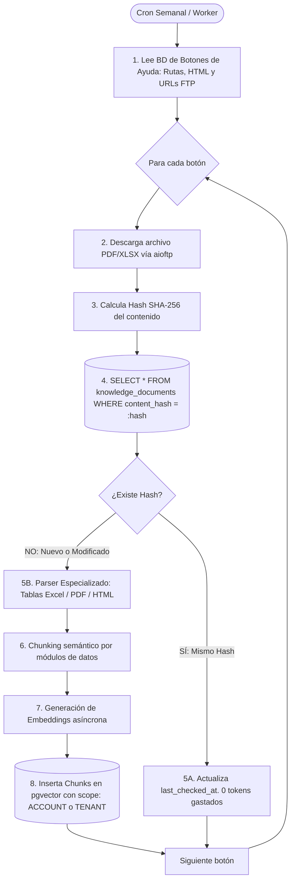

# Plan de Desarrollo — Backend (Python 3.12+ / FastAPI / Clean Architecture)
## SaaS B2B de Asistencia Inteligente y Diagnóstico RAG Multi-Nivel (Sector Salud)

> **Contexto del proyecto (para agentes o lectores sin contexto previo)**
> Producto SaaS B2B llamado provisionalmente **[NOMBRE_PRODUCTO]**: un Core Backend y Motor RAG Multi-Nivel especializado en el sector salud.
> El sistema recibe consultas de médicos, auditores y personal administrativo junto con **logs de error del sistema, contexto de navegación (pantallas y botones activos) y preguntas sobre cargues complejos (ej. Cáncer Tipo 2, patologías de alto costo con más de 300 variables)**, resolviendo las fallas en lenguaje técnico claro y citando normativas aplicables.
> 
> **División de Responsabilidades:** El equipo del cliente/partner construye el frontend de sus aplicaciones y el widget embebible; nuestro equipo construye la **API Backend Core (Python), el Motor RAG Multi-Nivel, la Ingesta de Documentos/FTP/Logs y las Consolas de Administración**.
> 
> Para el contexto de negocio completo y casos de uso, ver [especificacion-sistema-completa.md](file:///d:/Git/SaaS/especificacion-sistema-completa.md) y [arquitectura-y-retos-tecnicos-python.md](file:///d:/Git/SaaS/arquitectura-y-retos-tecnicos-python.md).

---

## 1. Objetivo del Backend

Construir una plataforma backend modular de alto rendimiento en **Python 3.12+** que proporcione:
1. **API de Diagnóstico y Consulta en Tiempo Real (`/api/v1/diagnostic/query` y `/stream` SSE):** Procesa consultas enriquecidas con logs de error del sistema, identificadores de botones/formularios y rol de usuario con streaming de baja latencia.
2. **Motor RAG con Herencia Multi-Nivel:** Búsqueda vectorial jerárquica que combina normativas de salud globales (Nivel 1), directrices de la empresa prestadora/Account (Nivel 2) y documentación local de cada IPS/Tenant (Nivel 3).
3. **Pipeline de Ingesta Asíncrona con FTP & Deduplicación SHA-256:** Mapeo de botones desde la base de datos de origen, descarga de archivos desde servidores FTP, cálculo de `content_hash` para deduplicación total y parsing de PDFs y Excels de 300+ variables.
4. **Seguridad y Aislamiento Estricto:** Políticas RLS y filtrado jerárquico en PostgreSQL con `pgvector`, autenticación de widgets mediante API Key + JWT de sesión, y validación dinámica de CORS.
5. **Observabilidad y Ledger de Consumo:** Trazabilidad exacta de tokens (input/output/embeddings), latencias y costos atribuidos a cada Tenant y Account.

---

## 2. Arquitectura del Sistema (Clean Architecture / Hexagonal en Python)

Se implementa una **Arquitectura Hexagonal (Ports & Adapters)** estructurada de forma modular:

```
backend/
├── src/
│   ├── domain/                         # Capa de Dominio (Pura POO, sin frameworks)
│   │   ├── entities/                   # Entidades (Tenant, Account, Document, Chunk, UsageLedger)
│   │   ├── value_objects/              # Scope (GLOBAL/ACCOUNT/TENANT), ContentHash, Severity
│   │   └── exceptions/                 # TenantNotFoundException, DocumentParsingException
│   │
│   ├── application/                    # Casos de Uso y Puertos (Interfaces Abstractas)
│   │   ├── ports/
│   │   │   ├── vector_store_port.py    # Repositorio de pgvector
│   │   │   ├── llm_port.py             # Cliente de inferencia LLM
│   │   │   ├── embedding_port.py       # Generador de embeddings
│   │   │   ├── ftp_client_port.py      # Cliente de descarga FTP
│   │   │   └── source_db_port.py       # Lector de la BD de botones de ayuda
│   │   └── use_cases/
│   │       ├── diagnose_query_use_case.py
│   │       ├── sync_ftp_help_buttons_use_case.py
│   │       └── ingest_document_use_case.py
│   │
│   ├── infrastructure/                 # Adaptadores de Infraestructura y Drivers
│   │   ├── db/                         # PostgreSQL + SQLAlchemy 2.0 Async + asyncpg
│   │   │   ├── models/                 # Modelos ORM relacionales y vectoriales
│   │   │   └── repositories/           # Implementación concreta de VectorStorePort
│   │   ├── ai/                         # Adaptadores LiteLLM / AsyncOpenAI / Anthropic
│   │   ├── ftp/                        # Adaptador aioftp
│   │   └── workers/                    # Workers asíncronos para tareas en background
│   │
│   └── api/                            # Adaptador Primario (FastAPI Framework)
│       ├── v1/
│       │   ├── diagnostic_router.py    # Endpoints de consulta y streaming SSE
│       │   ├── session_router.py       # Autenticación y emisión de JWT para el widget
│       │   └── admin_router.py         # Endpoints para las consolas web de gestión
│       └── middlewares/                # CORS dinámico, API Key validation, Rate Limiting
```

**Regla de Dependencia Estricta:** `api` $\rightarrow$ `application` $\rightarrow$ `domain`. La capa `infrastructure` implementa los puertos definidos en `application`. El dominio permanece 100% agnóstico de frameworks.

---

## 3. Stack Tecnológico

| Componente | Tecnología Seleccionada | Justificación Técnica |
|---|---|---|
| **Lenguaje / Runtime** | Python 3.12+ (AsyncIO) | Ecosistema líder en IA, procesamiento de texto/tablas y soporte nativo asíncrono para I/O intensivo. |
| **Framework Web API** | FastAPI + Pydantic v2 | Alto rendimiento (comparable a Go/Node), tipado estricto con validaciones en Rust y generación automática de OpenAPI. |
| **Persistencia & Vectores** | PostgreSQL 16 + extensión `pgvector` | Base unificada para datos relacionales, JSONB y vectores con soporte de índices HNSW para búsqueda ultrarrápida. |
| **ORM / Acceso a Datos** | SQLAlchemy 2.0 Async + `asyncpg` | Acceso asíncrono no bloqueante a PostgreSQL con soporte para el tipo `Vector` de pgvector. |
| **Integración con IA / LLMs** | LiteLLM / AsyncOpenAI / Anthropic SDKs | Puertos desacoplados para alternar dinámicamente entre DeepSeek, Claude 3.5 Sonnet y GPT-4o. |
| **Parsing Documental & Tablas** | `openpyxl`, `pdfplumber`, `BeautifulSoup4` | Extracción precisa de matrices Excel de 300+ variables, PDFs normativos y contenido HTML de botones. |
| **Cliente FTP Asíncrono** | `aioftp` | Descarga de archivos remotos desde los servidores FTP de los clientes sin bloquear el event loop. |
| **Procesamiento en Background** | AsyncIO Background Tasks / Celery / ARQ | Ejecución programada (cron) y sincronización de fuentes documentales. |
| **Migraciones de BD** | Alembic | Control de versiones auditable del esquema SQL, extensiones vectoriales e índices HNSW. |
| **Testing** | `pytest` + `pytest-asyncio` + Testcontainers | Pruebas unitarias de casos de uso y pruebas de integración contra PostgreSQL/pgvector real. |

---

## 4. Modelo de Datos y Esquema SQL Multi-Nivel

```sql
-- Extensiones requeridas
CREATE EXTENSION IF NOT EXISTS "uuid-ossp";
CREATE EXTENSION IF NOT EXISTS "vector";
CREATE EXTENSION IF NOT EXISTS "pg_trgm";

-- 1. Nivel Platform / Account / Tenant
CREATE TABLE accounts (
    account_id UUID PRIMARY KEY DEFAULT uuid_generate_v4(),
    nombre VARCHAR(255) NOT NULL,
    plan VARCHAR(50) NOT NULL DEFAULT 'ENTERPRISE_HEALTH',
    max_tenants INT NOT NULL DEFAULT 20,
    max_tokens_mes BIGINT NOT NULL DEFAULT 50000000,
    status VARCHAR(20) NOT NULL DEFAULT 'ACTIVE',
    created_at TIMESTAMP WITH TIME ZONE DEFAULT NOW()
);

CREATE TABLE tenants (
    tenant_id UUID PRIMARY KEY DEFAULT uuid_generate_v4(),
    account_id UUID NOT NULL REFERENCES accounts(account_id) ON DELETE CASCADE,
    nombre VARCHAR(255) NOT NULL,
    codigo_ips VARCHAR(100), -- Identificador clínico (ej. Sura, Sanitas, etc.)
    dominios_permitidos TEXT[] NOT NULL DEFAULT '{}',
    status VARCHAR(20) NOT NULL DEFAULT 'ACTIVE',
    created_at TIMESTAMP WITH TIME ZONE DEFAULT NOW()
);

-- 2. Auth del Widget
CREATE TABLE api_keys (
    key_id UUID PRIMARY KEY DEFAULT uuid_generate_v4(),
    tenant_id UUID NOT NULL REFERENCES tenants(tenant_id) ON DELETE CASCADE,
    key_hash VARCHAR(255) NOT NULL UNIQUE,
    key_prefix VARCHAR(16) NOT NULL, -- ej. pk_live_
    created_at TIMESTAMP WITH TIME ZONE DEFAULT NOW(),
    revoked_at TIMESTAMP WITH TIME ZONE
);

-- 3. Base de Conocimiento Jerárquica con Control de Hash
CREATE TYPE knowledge_scope_enum AS ENUM ('GLOBAL', 'ACCOUNT', 'TENANT');
CREATE TYPE document_category_enum AS ENUM (
    'NORMATIVA_SALUD',      -- Resoluciones del ministerio, guías clínicas
    'GUIA_CARGUE',          -- Manuales de cargue de cáncer tipo 2, cuentas médicas
    'MAPA_UI_BOTONES',      -- Diccionario de botones, rutas y pantallas de la app host
    'CATALOGO_ERRORES'      -- Mapeo de códigos de error de sistema y logs a soluciones
);

CREATE TABLE knowledge_documents (
    document_id UUID PRIMARY KEY DEFAULT uuid_generate_v4(),
    scope knowledge_scope_enum NOT NULL,
    account_id UUID REFERENCES accounts(account_id) ON DELETE CASCADE,
    tenant_id UUID REFERENCES tenants(tenant_id) ON DELETE CASCADE,
    titulo VARCHAR(255) NOT NULL,
    categoria document_category_enum NOT NULL,
    source_url TEXT,                              -- Ruta en FTP o URL de origen
    content_hash VARCHAR(64) NOT NULL,            -- SHA-256 del contenido (para deduplicación)
    version INT NOT NULL DEFAULT 1,
    is_active BOOLEAN NOT NULL DEFAULT TRUE,
    metadatos_doc JSONB DEFAULT '{}',             -- { "button_id": "btn_radicar", "screen": "RADICACION" }
    last_checked_at TIMESTAMP WITH TIME ZONE DEFAULT NOW(),
    uploaded_at TIMESTAMP WITH TIME ZONE DEFAULT NOW(),
    CONSTRAINT chk_scope_ids CHECK (
        (scope = 'GLOBAL' AND account_id IS NULL AND tenant_id IS NULL) OR
        (scope = 'ACCOUNT' AND account_id IS NOT NULL AND tenant_id IS NULL) OR
        (scope = 'TENANT' AND account_id IS NOT NULL AND tenant_id IS NOT NULL)
    )
);

CREATE TABLE knowledge_chunks (
    chunk_id UUID PRIMARY KEY DEFAULT uuid_generate_v4(),
    document_id UUID NOT NULL REFERENCES knowledge_documents(document_id) ON DELETE CASCADE,
    scope knowledge_scope_enum NOT NULL,
    account_id UUID REFERENCES accounts(account_id),
    tenant_id UUID REFERENCES tenants(tenant_id),
    categoria document_category_enum NOT NULL,
    contenido TEXT NOT NULL,
    embedding VECTOR(1536) NOT NULL,              -- Vector de OpenAI (text-embedding-3-small) o DeepSeek
    metadatos_chunk JSONB NOT NULL DEFAULT '{}',  -- { "campo": "estadio_tnm", "cod_error": "ERR_MED_TNM_404" }
    is_active BOOLEAN NOT NULL DEFAULT TRUE,
    created_at TIMESTAMP WITH TIME ZONE DEFAULT NOW()
);

-- Índices HNSW, GIN y de Jerarquía
CREATE INDEX idx_chunks_embedding_hnsw ON knowledge_chunks 
USING hnsw (embedding vector_cosine_ops) WITH (m = 16, ef_construction = 64);

CREATE INDEX idx_chunks_metadata_gin ON knowledge_chunks USING gin (metadatos_chunk);
CREATE INDEX idx_docs_content_hash ON knowledge_documents (content_hash);
CREATE INDEX idx_chunks_hierarchy ON knowledge_chunks (scope, account_id, tenant_id, is_active, categoria);

-- 4. Ledger de Consumo y Diagnósticos
CREATE TABLE ai_usage_ledger (
    ledger_id UUID PRIMARY KEY DEFAULT uuid_generate_v4(),
    account_id UUID NOT NULL REFERENCES accounts(account_id),
    tenant_id UUID REFERENCES tenants(tenant_id),
    operacion VARCHAR(50) NOT NULL, -- EMBEDDING_INGESTION, DIAGNOSTIC_QUERY
    tokens_input INT NOT NULL,
    tokens_output INT NOT NULL,
    costo_usd NUMERIC(10, 6) NOT NULL,
    latencia_ms INT NOT NULL,
    created_at TIMESTAMP WITH TIME ZONE DEFAULT NOW()
);
```

---

## 5. Pipeline de Ingesta: BD de Botones + FTP + Hash Deduplication



---

## 6. Pipeline de Retrieval y Diagnóstico en Tiempo Real

### 6.1 Contrato del Endpoint de Diagnóstico y Streaming

`POST /api/v1/diagnostic/stream` (o `/query` para modo síncrono)

**Payload de Entrada (Enviado por el widget del cliente):**
```json
{
  "query": "Me sale un error al radicar el reporte de cáncer tipo 2 y no me deja continuar.",
  "system_logs": "ERROR [2026-08-22 10:15:02] FormCancerT2Validator: Field 'estadio_clinico_tnm' is required when 'tipo_neoplasia' = 02. Validation code: ERR_MED_TNM_404",
  "ui_context": {
    "current_url": "https://ips-sanrafael.med.co/radicacion/cancer/formulario",
    "active_screen": "RADICACION_PATOLOGIAS_ALTO_COSTO",
    "active_button_id": "btn_validar_y_radicar",
    "form_code": "FORM_CANCER_TIPO_2",
    "field_in_focus": "estadio_clinico_tnm"
  },
  "user_profile": {
    "role": "MEDICO_AUDITOR",
    "user_display_name": "Dr. Juan Pérez"
  }
}
```

### 6.2 Estrategia de Búsqueda Vectorial Híbrida y Re-Ranking
1. **Generación de Embedding de Consulta:** Vectorización combinada de `query + logs + active_button_id`.
2. **Filtrado Multinivel y Búsqueda por Similitud de Coseno:**
   - Chunks locales de la IPS (Nivel 3).
   - Chunks de directrices del Account prestador (Nivel 2).
   - Chunks de normativas de salud globales (Nivel 1).
3. **Keyword Matching (Trigram / Full-Text):** Búsqueda exacta del código de error extraído del log (`ERR_MED_TNM_404`).
4. **Re-Ranking:** Ponderación con mayor prioridad a chunks que coincidan exactamente con el código de error, el formulario activo y el nivel de Tenant.

---

## 7. Fases de Desarrollo del Backend (3 Meses)

```
Mes 1: Core Python, Clean Architecture & Ingesta FTP con Hashing
├── Sem 1-2: Setup FastAPI, SQLAlchemy 2.0 Async, pgvector, modelo SQL y auth de API keys
└── Sem 3-4: Conector a BD de botones, cliente aioftp, deduplicación SHA-256 y parsers PDF/XLSX

Mes 2: Retrieval Jerárquico & Diagnostic API con SSE
├── Sem 5-6: Pipeline de búsqueda híbrida multinivel y re-ranking en pgvector
└── Sem 7-8: Endpoint de diagnóstico (/query y /stream SSE), prompt engine médico especializado

Mes 3: Observabilidad, Hardening & Piloto
├── Sem 9-10: Ledger de consumo de tokens por Tenant, rate limiting, validación CORS dinámica
└── Sem 11-12: Despliegue en GCP (Cloud Run + Cloud SQL), integración con widget del partner y piloto
```
