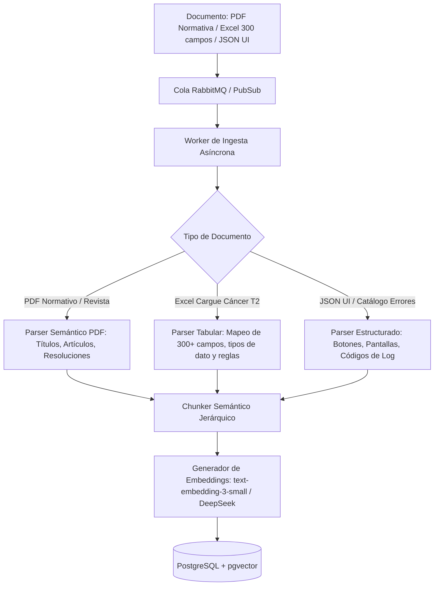

# Plan de Desarrollo — Backend (Java 21 + Spring Boot 3.x)
## SaaS B2B de Asistencia Inteligente y Diagnóstico RAG Multi-Nivel (Sector Salud)

> **Contexto del proyecto (para agentes o lectores sin contexto previo)**
> Producto SaaS B2B llamado provisionalmente **[NOMBRE_PRODUCTO]**: un Core Backend y Motor RAG Multi-Nivel especializado en el sector salud.
> El sistema recibe consultas de médicos, auditores y personal administrativo junto con **logs de error del sistema, contexto de navegación (pantallas y botones activos) y preguntas sobre cargues complejos (ej. Cáncer Tipo 2, patologías de alto costo con más de 300 variables)**, resolviendo las fallas en lenguaje técnico claro y citando normativas aplicables.
> 
> **División de Responsabilidades:** El equipo del cliente/partner construye el frontend de sus aplicaciones y el widget embebible; nuestro equipo construye la **API Backend Core, el Motor RAG Multi-Nivel, la Ingesta de Documentos/Logs y las Consolas de Administración**.
> 
> Para el contexto de negocio completo y casos de uso, ver [especificacion-sistema-completa.md](file:///d:/Git/SaaS/especificacion-sistema-completa.md).

---

## 1. Objetivo del Backend

Construir una plataforma backend modular de alto rendimiento que proporcione:
1. **API de Diagnóstico y Consulta en Tiempo Real (`/api/v1/diagnostic/query` y `/stream`):** Procesa consultas enriquecidas con logs de error del sistema, identificadores de botones/formularios y rol de usuario.
2. **Motor RAG con Herencia Multi-Nivel:** Búsqueda vectorial jerárquica que combina normativas de salud globales (Nivel 1), directrices de la empresa prestadora/Account (Nivel 2) y documentación local de cada IPS/Tenant (Nivel 3).
3. **Pipeline de Ingesta y Parseo Inteligente:** Procesamiento de resoluciones médicas en PDF, manuales de formularios complejos en Excel (300+ campos), taxonomías de botones de UI y catálogos de códigos de error.
4. **Seguridad y Aislamiento Estricto:** Políticas RLS multinivel en PostgreSQL con `pgvector`, autenticación de widgets mediante API Key + JWT de sesión, y validación dinámica de CORS.
5. **Observabilidad y Ledger de Consumo:** Trazabilidad exacta de tokens (input/output/embeddings), latencias y costos atribuidos a cada Tenant y Account.

---

## 2. Arquitectura del Sistema

### 2.1 Estilo Arquitectónico
Se implementa una **Arquitectura Hexagonal (Ports & Adapters)** estructurada como **Monolito Modular** en Java 21 LTS con Spring Boot 3.3+. 

```
com.tuempresa.plataforma
│
├── platform-core/            ← Gestión de Accounts, Tenants multinivel, API keys y roles
├── knowledge-ingestion/      ← Parsers (PDF/Excel/JSON), chunkers especializados, embeddings
├── knowledge-retrieval/      ← Búsqueda híbrida en pgvector, filtrado multinivel, prompt synthesis
├── diagnostic-gateway/       ← Endpoints públicos para el widget del cliente, auth, rate limiting
└── usage-observability/      ← Ledger de consumo de tokens, métricas y auditoría de diagnósticos
```

### 2.2 Estructura Interna por Módulo

```
modulo/
├── domain/                  ← Entidades puras, Value Objects (TenantId, DiagnosticContext), reglas de negocio
├── application/             ← Casos de uso (DiagnoseErrorUseCase, IngestHealthNormativeUseCase) y Puertos (Interfaces)
├── infrastructure/          ← Adaptadores: Repositorios Spring Data JPA, pgvector, Clientes WebClient (Claude/OpenAI/DeepSeek), RabbitMQ
└── api/                     ← REST Controllers, DTOs de request/response, Mappers MapStruct, Seguridad
```

**Regla de Dependencia Estricta:** `api` $\rightarrow$ `application` $\rightarrow$ `domain`. La capa `infrastructure` implementa los puertos definidos en `application`. El dominio permanece 100% agnóstico de frameworks.

---

## 3. Stack Tecnológico

| Componente | Tecnología Seleccionada | Justificación Técnica |
|---|---|---|
| **Lenguaje / Runtime** | Java 21 LTS (Virtual Threads habilitados) | Alta concurrencia sin bloqueo de hilos en llamadas I/O intensivas a APIs de IA y base de datos. |
| **Framework Base** | Spring Boot 3.3+ / Spring Security | Ecosistema enterprise, inyección de dependencias robusta, soporte para GraalVM y Virtual Threads. |
| **Persistencia & Vectores** | PostgreSQL 16 + extensión `pgvector` | Base unificada para datos relacionales, JSONB y vectores; soporte de índices HNSW para búsqueda rápida por similitud de coseno. |
| **Integración con IA / LLMs** | Spring WebClient reactivo / Spring AI | Comunicación asíncrona no bloqueante con DeepSeek, Claude 3.5 Sonnet y OpenAI GPT-4o. |
| **Colas de Procesamiento** | RabbitMQ (o Cloud Pub/Sub en GCP) | Desacoplamiento de la ingesta pesada de PDFs normativos y Excels de 300+ campos del tráfico interactivo. |
| **Migraciones de BD** | Flyway | Control de versiones auditable del esquema SQL y políticas RLS multinivel. |
| **Testing** | JUnit 5 + Mockito + Testcontainers (PostgreSQL con pgvector real) | Validación automatizada y rigurosa del aislamiento RLS y precisión de búsqueda vectorial. |
| **Documentación de API** | Springdoc-OpenAPI (Swagger v3) | Generación automática de contratos para el equipo de frontend del cliente. |

---

## 4. Modelo de Datos y Esquema SQL Multi-Nivel

```sql
-- Habilitar extensiones requeridas
CREATE EXTENSION IF NOT EXISTS "uuid-ossp";
CREATE EXTENSION IF NOT EXISTS "vector";
CREATE EXTENSION IF NOT EXISTS "pg_trgm";

-- 1. Nivel Platform / Account / Tenant
CREATE TABLE accounts (
    account_id UUID PRIMARY KEY DEFAULT uuid_generate_v4(),
    nombre VARCHAR(255) NOT NULL,
    plan VARCHAR(50) NOT NULL DEFAULT 'ENTERPRISE_HEALTH',
    max_tenants INT NOT NULL DEFAULT 20,
    max_tokens_mes BIGINT NOT NULL DEFAULT 50000000,
    status VARCHAR(20) NOT NULL DEFAULT 'ACTIVE',
    created_at TIMESTAMP WITH TIME ZONE DEFAULT NOW()
);

CREATE TABLE tenants (
    tenant_id UUID PRIMARY KEY DEFAULT uuid_generate_v4(),
    account_id UUID NOT NULL REFERENCES accounts(account_id) ON DELETE CASCADE,
    nombre VARCHAR(255) NOT NULL,
    codigo_ips VARCHAR(100), -- Identificador clínico de la entidad
    dominios_permitidos TEXT[] NOT NULL DEFAULT '{}',
    status VARCHAR(20) NOT NULL DEFAULT 'ACTIVE',
    created_at TIMESTAMP WITH TIME ZONE DEFAULT NOW()
);

-- 2. Auth del Widget
CREATE TABLE api_keys (
    key_id UUID PRIMARY KEY DEFAULT uuid_generate_v4(),
    tenant_id UUID NOT NULL REFERENCES tenants(tenant_id) ON DELETE CASCADE,
    key_hash VARCHAR(255) NOT NULL UNIQUE,
    key_prefix VARCHAR(16) NOT NULL, -- ej. pk_live_
    created_at TIMESTAMP WITH TIME ZONE DEFAULT NOW(),
    revoked_at TIMESTAMP WITH TIME ZONE
);

-- 3. Base de Conocimiento Jerárquica
CREATE TYPE knowledge_scope_enum AS ENUM ('GLOBAL', 'ACCOUNT', 'TENANT');
CREATE TYPE document_category_enum AS ENUM (
    'NORMATIVA_SALUD',      -- Resoluciones del ministerio, guías clínicas
    'GUIA_CARGUE',          -- Manuales de cargue de cáncer tipo 2, cuentas médicas
    'MAPA_UI_BOTONES',      -- Diccionario de botones, rutas y pantallas de la app host
    'CATALOGO_ERRORES'      -- Mapeo de códigos de error de sistema y logs a soluciones
);

CREATE TABLE knowledge_documents (
    document_id UUID PRIMARY KEY DEFAULT uuid_generate_v4(),
    scope knowledge_scope_enum NOT NULL,
    account_id UUID REFERENCES accounts(account_id) ON DELETE CASCADE,
    tenant_id UUID REFERENCES tenants(tenant_id) ON DELETE CASCADE,
    titulo VARCHAR(255) NOT NULL,
    categoria document_category_enum NOT NULL,
    tipo_archivo VARCHAR(50) NOT NULL, -- PDF, XLSX, JSON
    version VARCHAR(20) DEFAULT '1.0',
    estado_procesamiento VARCHAR(20) NOT NULL DEFAULT 'PENDING',
    metadatos_doc JSONB DEFAULT '{}',
    uploaded_at TIMESTAMP WITH TIME ZONE DEFAULT NOW(),
    CONSTRAINT chk_scope_ids CHECK (
        (scope = 'GLOBAL' AND account_id IS NULL AND tenant_id IS NULL) OR
        (scope = 'ACCOUNT' AND account_id IS NOT NULL AND tenant_id IS NULL) OR
        (scope = 'TENANT' AND account_id IS NOT NULL AND tenant_id IS NOT NULL)
    )
);

CREATE TABLE knowledge_chunks (
    chunk_id UUID PRIMARY KEY DEFAULT uuid_generate_v4(),
    document_id UUID NOT NULL REFERENCES knowledge_documents(document_id) ON DELETE CASCADE,
    scope knowledge_scope_enum NOT NULL,
    account_id UUID REFERENCES accounts(account_id),
    tenant_id UUID REFERENCES tenants(tenant_id),
    categoria document_category_enum NOT NULL,
    contenido TEXT NOT NULL,
    embedding VECTOR(1536) NOT NULL, -- Vector de OpenAI/DeepSeek
    metadatos_chunk JSONB NOT NULL DEFAULT '{}', -- campos: { cod_error: 'ERR_CANCER_02', boton: 'btn_radicar', form: 'CANCER_T2' }
    created_at TIMESTAMP WITH TIME ZONE DEFAULT NOW()
);

-- Índices Vectoriales y de Búsqueda
CREATE INDEX idx_chunks_embedding_hnsw ON knowledge_chunks 
USING hnsw (embedding vector_cosine_ops) WITH (m = 16, ef_construction = 64);

CREATE INDEX idx_chunks_metadata_gin ON knowledge_chunks USING gin (metadatos_chunk);
CREATE INDEX idx_chunks_hierarchy ON knowledge_chunks (scope, account_id, tenant_id, categoria);

-- 4. Ledger de Consumo y Diagnósticos
CREATE TABLE ai_usage_ledger (
    ledger_id UUID PRIMARY KEY DEFAULT uuid_generate_v4(),
    account_id UUID NOT NULL REFERENCES accounts(account_id),
    tenant_id UUID REFERENCES tenants(tenant_id),
    operacion VARCHAR(50) NOT NULL, -- EMBEDDING_INGESTION, DIAGNOSTIC_QUERY
    tokens_input INT NOT NULL,
    tokens_output INT NOT NULL,
    costo_usd NUMERIC(10, 6) NOT NULL,
    latencia_ms INT NOT NULL,
    created_at TIMESTAMP WITH TIME ZONE DEFAULT NOW()
);
```

### 4.1 Políticas RLS Multi-Nivel
A nivel de base de datos, el usuario de aplicación consulta utilizando variables de sesión fijadas por la transacción:

```sql
ALTER TABLE knowledge_chunks ENABLE ROW LEVEL SECURITY;

CREATE POLICY multi_level_retrieval_policy ON knowledge_chunks
FOR SELECT USING (
    scope = 'GLOBAL'
    OR (scope = 'ACCOUNT' AND account_id = current_setting('app.current_account_id', true)::uuid)
    OR (scope = 'TENANT' AND tenant_id = current_setting('app.current_tenant_id', true)::uuid)
);
```

---

## 5. Pipeline de Ingesta Inteligente Especializada



### Estrategias de Chunking por Tipo de Contenido
1. **Normativas de Salud y Revistas Clínicas (PDF):**
   - Chunking por artículos/secciones normativas respetando la jerarquía legal (ej. "Artículo 4 - Obligatoriedad de reporte de Cáncer Gástrico").
   - Preservación de citas bibliográficas y números de resolución en el metadato.
2. **Guías de Cargue de Datos Complejos (Excel / 300+ Campos):**
   - Agrupación por módulos de datos (ej. "Datos del Paciente", "Estadificación TNM", "Tratamiento Quimioterapéutico", "Validaciones de Fecha").
   - Cada chunk incluye el nombre del campo, tipo de dato esperado, regla de obligatoriedad y código de error asociado si falla la validación.
3. **Mapeo de UI, Botones y Logs de Error:**
   - Indexación directa de códigos de error (ej. `ERR_VAL_042`, `HTTP_500_SOAP_RADICACION`) vinculados a la pantalla y botón exacto de donde se originan.

---

## 6. Pipeline de Retrieval y Diagnóstico en Tiempo Real

### 6.1 Contrato del Endpoint de Diagnóstico

`POST /api/v1/diagnostic/query`

**Payload de Entrada (Enviado por el widget del cliente):**
```json
{
  "query": "Me sale un error al radicar el reporte de cáncer tipo 2 y no me deja continuar.",
  "system_logs": "ERROR [2026-08-22 10:15:02] FormCancerT2Validator: Field 'estadio_clinico_tnm' is required when 'tipo_neoplasia' = 02. Validation code: ERR_MED_TNM_404",
  "ui_context": {
    "current_url": "https://ips-sanrafael.med.co/radicacion/cancer/formulario",
    "active_screen": "RADICACION_PATOLOGIAS_ALTO_COSTO",
    "active_button_id": "btn_validar_y_radicar",
    "form_code": "FORM_CANCER_TIPO_2",
    "field_in_focus": "estadio_clinico_tnm"
  },
  "user_profile": {
    "role": "MEDICO_AUDITOR",
    "user_display_name": "Dr. Juan Pérez"
  }
}
```

### 6.2 Estrategia de Búsqueda Vectorial Híbrida y Re-Ranking
1. **Generación de Embedding de Consulta:** Vectorización combinada de `query + logs + active_button_id`.
2. **Filtrado Multinivel y Búsqueda por Similitud de Coseno:**
   - Chunks locales de la IPS (Nivel 3).
   - Chunks de directrices del Account prestador (Nivel 2).
   - Chunks de normativas de salud globales (Nivel 1).
3. **Keyword Matching (Trigram / Full-Text):** Búsqueda exacta del código de error extraído del log (`ERR_MED_TNM_404`).
4. **Re-Ranking:** Ponderación con mayor prioridad a chunks que coincidan exactamente con el código de error y el formulario activo.

### 6.3 Prompt Engine Especializado (Persona Médica / Auditor)

```text
Eres el Asistente Técnico y Normativo Especializado para Plataformas de Salud de [NOMBRE_PRODUCTO].
Tu objetivo es guiar a médicos, auditores y personal asistencial para resolver dudas de diligenciamiento y errores de sistema.

CONTEXTO DEL USUARIO:
- Rol: {{user_profile.role}}
- Pantalla Activa: {{ui_context.active_screen}} (Botón: {{ui_context.active_button_id}})
- Formulario: {{ui_context.form_code}}
- Log de Error Detectado: {{system_logs}}

DOCUMENTACIÓN TÉCNICA Y NORMATIVA RECUPERADA:
{{retrieved_chunks}}

INSTRUCCIONES DE RESPUESTA:
1. Responde en español con un tono profesional, técnico-médico claro y directo.
2. Si se detecta un error de log:
   a. Explica la causa raíz en términos funcionales (qué dato falta o qué validación normativa falló).
   b. Proporciona los pasos exactos de solución en la interfaz (qué campo corregir o qué botón presionar).
   c. Cita la resolución o guía técnica de soporte correspondiente.
3. No uses tecnicismos de programación genéricos innecesarios; traduce el error al proceso clínico/administrativo correspondiente.
```

**Payload de Respuesta:**
```json
{
  "response": "Estimado Dr. Pérez, el error **ERR_MED_TNM_404** ocurre porque para el tipo de neoplasia seleccionado (Cáncer Tipo 2), el campo **Estadificación Clínica TNM** es de diligenciamiento obligatorio según la Resolución de Cuentas de Alto Costo.\n\n### Pasos para solucionarlo:\n1. Ubíquese en la pestaña **Estadificación y Diagnóstico** del formulario.\n2. Ingrese los valores de Tumor (T), Nódulo (N) y Metástasis (M).\n3. Haga clic nuevamente en el botón **Validar y Radicar**.\n\n*Fuente: Guía Técnica de Cargue de Cáncer v3.2 (Sección 4.1) y Resolución Ministerial 0247.*",
  "error_diagnostic": {
    "detected_code": "ERR_MED_TNM_404",
    "affected_field": "estadio_clinico_tnm",
    "severity": "BLOCKING"
  },
  "sources": [
    {
      "document_title": "Guía_Cargue_Cancer_Alto_Costo_2026.pdf",
      "scope": "GLOBAL",
      "section": "Sección 4.1 - Validación TNM"
    }
  ]
}
```

---

## 7. Fases de Desarrollo del Backend (3 Meses)

```
Mes 1: Core & Ingesta Inteligente
├── Sem 1-2: Arquitectura Hexagonal, Modelo SQL en pgvector con RLS multinivel, auth de API keys
└── Sem 3-4: Parsers de PDFs normativos, Excel (300+ campos) y JSON de botones/errores

Mes 2: Retrieval Jerárquico & Diagnostic API
├── Sem 5-6: Pipeline de búsqueda híbrida multinivel y re-ranking en pgvector
└── Sem 7-8: Endpoint de diagnóstico (/api/v1/diagnostic/query y SSE), prompt engine médico

Mes 3: Observabilidad, Hardening & Piloto
├── Sem 9-10: Ledger de consumo de tokens por Tenant, rate limiting, validación CORS dinámica
└── Sem 11-12: Pruebas de carga, integración end-to-end con widget del partner y despliegue piloto
```
